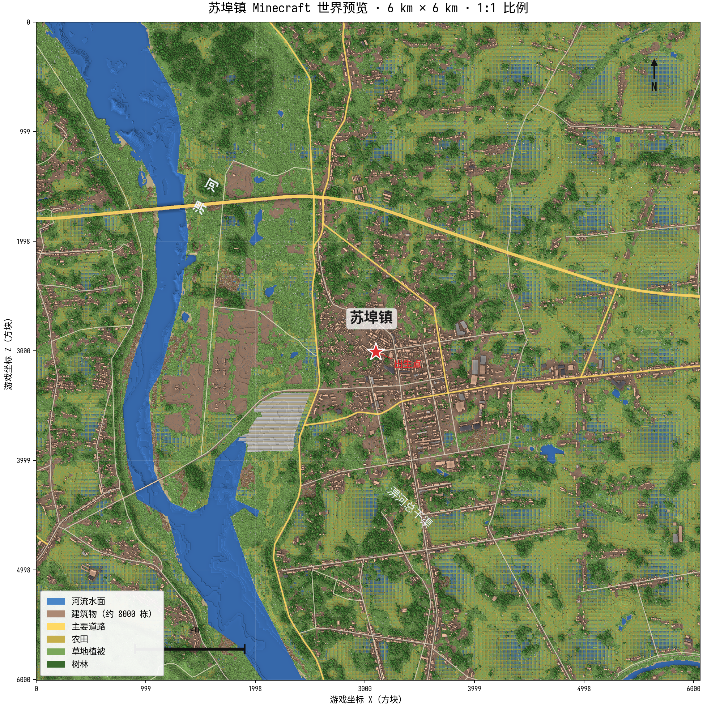

<div align="center">

# 苏埠镇 · Minecraft 世界复刻

**安徽省六安市裕安区苏埠镇及周边环境** 的 1:1 比例 Minecraft Java 版世界存档

由 [Arnis](https://github.com/louis-e/arnis) 基于真实地理数据自动生成

</div>

---

## 世界预览



> 俯视图基于实际生成的 Minecraft 世界数据渲染：淠河自西北向东南流经镇西侧，镇区建筑群位于图像中部，农田、树林按真实土地覆盖数据生成。

## 项目简介

本项目将 **苏埠镇**（安徽省六安市裕安区，地处淠河东岸）及周边约 **6 km × 6 km** 的真实环境复刻进了 Minecraft。世界中的地形起伏、河流水系、道路街巷、建筑物均来自真实地图数据，其中建筑含高度信息，地形含真实高程。

**生成范围**（以镇中心为中心）：

| 项目 | 数值 |
|------|------|
| 中心坐标 | 北纬 31.634°，东经 116.355° |
| 覆盖范围 | 约 6 km × 6 km（36 km²） |
| 涵盖地理 | 苏埠镇镇区、淠河（西）、淠河总干渠（东）、周边村落农田 |
| 世界比例 | 1:1（1 方块 = 1 米） |
| 地形高程 | 真实高程数据（Mapterhorn 混合源） |
| 建筑数据 | OSM + Overture Maps（含高度） |

## 下载使用

1. 前往本仓库 **[Releases](../../releases)** 页面，下载最新的 `.zip` 存档
2. 解压 zip，得到 `SubuTown` 世界文件夹
3. 将整个文件夹复制到 Minecraft 的 `saves` 目录：
   - **Windows**：`%APPDATA%\.minecraft\saves\`
   - **macOS**：`~/Library/Application Support/minecraft/saves/`
   - **Linux**：`~/.minecraft/saves/`
4. 启动 Minecraft **Java 版 1.21.4 或更高版本**，在单人游戏列表中选择该世界即可

> 存档 `DataVersion` 为 4189（对应 1.21.4），更高版本游戏打开时会自动安全升级。
> 首次打开世界时游戏需要几秒钟转换区块数据，属正常现象。

## 世界特色

- **真实地形**：使用真实高程数据生成地形起伏，苏埠镇周边的岗地、平原与河谷均可辨认
- **淠河水系**：镇西侧的淠河与东侧的淠河总干渠均按真实位置与走向生成
- **道路网络**：镇区街巷、乡村道路、主要公路按 OSM 真实路网铺设
- **建筑物**：约 8,000 栋建筑（含 Overture 高度数据），按真实位置与占地生成
- **植被**：根据真实生态区域（长江平原常绿林区）自动配置树种
- **地下填充**：开启 `fillground`，地表下为石头与矿石层，可直接进入生存模式游玩

## 地图对照

在游戏内按 **F3** 可查看坐标。经纬度与游戏坐标近似换算：

```
游戏 X ≈ (经度 - 116.355) × 94,780
游戏 Z ≈ (31.634 - 纬度) × 111,320
```

例如镇中心淠河一侧（约东经 116.334、北纬 31.634）对应游戏坐标约 `X ≈ -1,990, Z ≈ 0`。

## 如何重新生成 / 自定义

本世界由 [Arnis v3.2.0](https://github.com/louis-e/arnis) 生成，完整命令：

```bash
arnis --bbox "31.607,116.323,31.661,116.387" \
      --output-dir ./worlds \
      --fillground \
      --spawn-lat 31.6339 --spawn-lng 116.3557
```

出生点设置在镇中心道路（游戏坐标 X 3097 / Y -33 / Z 3010）。

如需扩大范围（全镇域约 12×11 km）、调整比例（如 1:2）或生成 Bedrock 版（`.mcworld`），可修改上述参数。全镇域生成需要较大内存（6 GB 以上）与较长生成时间。

## 数据来源

| 数据 | 来源 |
|------|------|
| 道路 / 水系 / 建筑轮廓 | [OpenStreetMap](https://www.openstreetmap.org)（ODbL 许可） |
| 建筑高度补充 | [Overture Maps Foundation](https://overturemaps.org) |
| 地形高程 | Mapterhorn / AWS Terrarium 高程瓦片 |
| 土地覆盖 | ESA WorldCover 2021 |
| 树冠高度 | Meta / WRI Global Canopy Height |

生成工具：[Arnis](https://github.com/louis-e/arnis) v3.2.0（GPL-3.0 许可）

---

<div align="center">

**OpenStreetMap 数据 © OpenStreetMap 贡献者（ODbL 许可）**

**Overture Maps 数据 © Overture Maps Foundation 贡献者（CDLA-Permissive 2.0 许可）**

</div>
